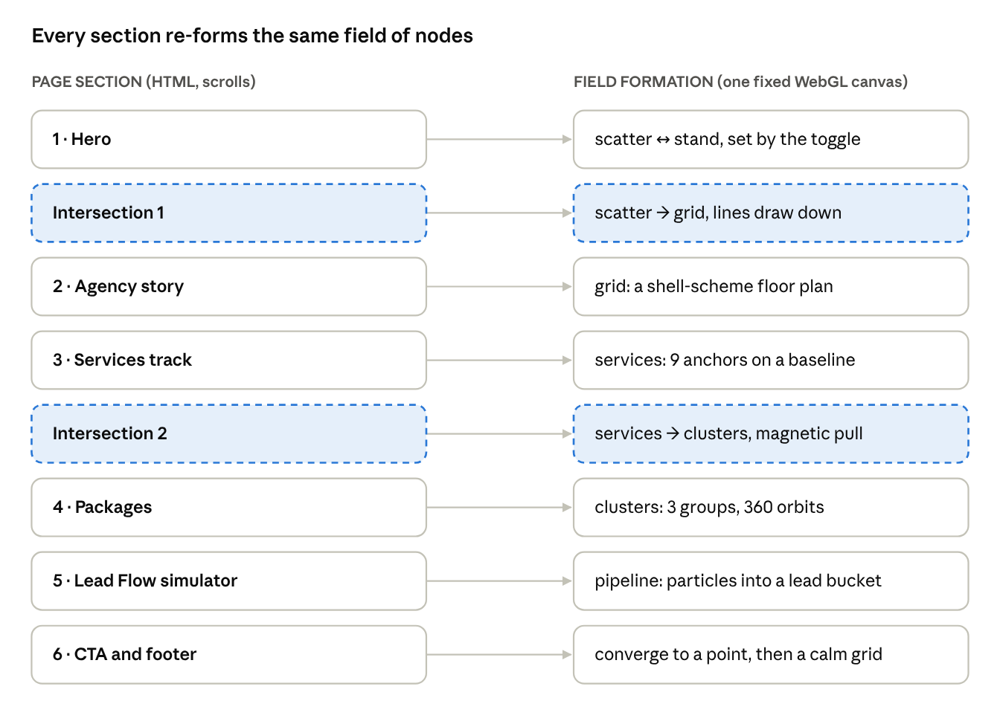
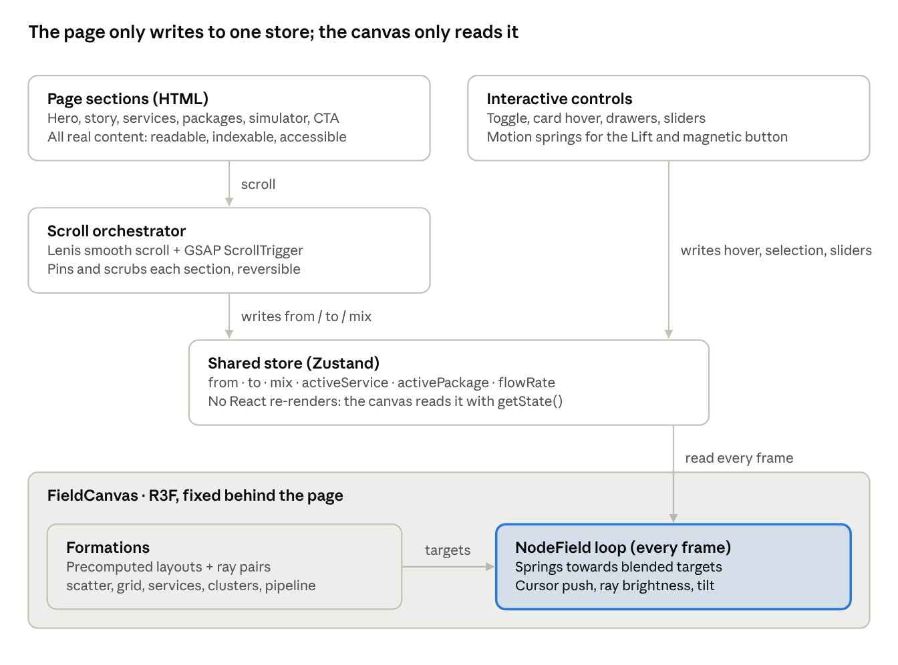

# Standout Homepage — Interactive Experience Blueprint

Oct 26, 2026 · @Uni

## Concept and visual narrative

The homepage is one continuous exhibition floor at night: a single field of light nodes runs behind the whole page and rebuilds itself as you scroll, from a constellation (the plan), to a floor grid (the stand), to nine service points, three package clusters and finally a lead pipeline. Sections never sit as boxes; they are views of the same structure, so the page feels like walking one hall rather than reading a brochure.

### The story the scroll tells

1. **Before** — scattered nodes: ideas, assets and channels not yet connected.
2. **During** — nodes lock into a structural grid and light rays connect them: the stand is live and visible.
3. **After** — the rays converge into a narrow channel that fills a lead counter: attention becomes pipeline.

Every section maps to one of those three states, which is also the hero toggle (Pre-Event / At the Event / Post-Event). The user can preview the whole story in the first screen, then live it by scrolling.

### The signature move: the Lift

The logo's raised O becomes the site's interaction grammar. Everything rests on a baseline; whatever the user points at lifts off it by a fixed step and turns Signal Orange. Cards, nodes, nav items and the CTA all use the same lift (18% of their own height for type, 8 px for UI). One rule, used everywhere, is what makes the motion feel designed rather than decorated.

### Colour

| Role | Name | Hex | Use |
| --- | --- | --- | --- |
| Page ground | Hall Black | #050A18 | Main background; a touch deeper than the logo navy so navy panels read as raised surfaces |
| Surface | Show Night | #0A1633 | Panels, cards, the structural grid fill |
| Accent | Signal Orange | #FF5A1F | Active node, lifted items, the one primary button per view. Never body text on navy below 18 px |
| Line, idle | Mist 16% | #E3E8F4 at 16% | Connection rays and grid lines at rest |
| Text | Mist | #E3E8F4 | Body and headings on dark |
| Text, quiet | Steel | #8C97B4 | Captions, labels (passes 4.5:1 on Hall Black) |

Orange is rationed: at most one orange element is dominant per screen, so it always marks “this one stands out”. The 360 package is the only place it glows.

### Typography

- **Funnel Display** — headlines, ExtraBold, tight tracking (−2% to −3%), very large on desktop (clamp 56–144 px). It is the base of the logo, so headlines and wordmark feel like one voice.
- **Geist** — body and UI, Regular/Medium, 17–19 px body on desktop.
- **Geist Mono** — labels, counters, stand-style tags (“HALL 3 · STAND B12”), the simulator numbers. Uppercase, +8% tracking.

### Motion principles

- **One field, many formations.** Transitions are the nodes travelling between layouts, never a fade between two pictures.
- **Springs, not tweens, for anything the cursor touches**; scrubbed timelines for anything the scroll drives. Scroll is always reversible.
- **Durations:** micro-interactions 180–260 ms, section morphs tied to roughly one viewport of scroll, nothing on a timer longer than 600 ms.
- **Easing:** expo-out for arrivals, a slightly underdamped spring (one small overshoot) for the lift.
- **Restraint:** the field dims to 35% opacity behind dense reading content, so text always wins.

## Section-by-section blueprint

Six sections and two intersections share one background field; each section gives that field a new formation. Copy below is a working draft for tone, to be replaced with approved lines.



Read down the page: each section on the left hands the shared field a new formation on the right; the two dashed rows are the intersections where the field visibly travels.

### 1. Hero — the hook

**Sees:** full-screen Hall Black. About 140 light nodes hang in shallow 3D depth as abstract exhibit panels (thin vertical planes) joined by faint rays. Top left, the STANDOUT wordmark; top right, nav (Services, Packages, Work, Contact) and an orange “Plan your show” button. Centre-left headline in Funnel Display at up to 144 px:

> Don’t just exhibit. **Stand out.**

Sub-line in Geist: “One team for everything before, during and after the show.” A mono tag above it reads HALL 01 · STAND 00.

**Cursor:** the field tilts up to 6° towards the pointer (spring, slight lag). Nodes within 120 px of the cursor are pushed away and their rays brighten, like a visitor walking through the hall. The custom cursor is a small orange ring that grows into a “drag” or “view” label over interactive items.

**Pre / At / Post toggle:** a three-segment control under the headline (real radio buttons). Selecting a state morphs the field in about 900 ms:

- **Pre-Event** — nodes scattered, rays dashed and faint; label: “Plan, design, invite.”
- **At the Event** — nodes snap into a stand grid, rays go solid, one node lifts and glows orange; label: “Be the stand people walk towards.”
- **Post-Event** — rays converge right into a single channel feeding a counter; label: “Turn conversations into pipeline.”

The toggle auto-advances every 5 s until the user touches it or scrolls.

**Scroll cue:** a thin orange baseline at the bottom edge with the word SCROLL lifting off it on a loop.

### Intersection 1 — hero into the agency story

As the user scrolls the first viewport, the hero text slides up and clips away along the baseline, while the nodes fall into columns and draw vertical lines downward. The lines meet horizontal lines drawn from the sides and lock into a structural grid, a shell-scheme floor plan seen from above. The grid cells become the containers of the story section: there is no seam between the two, because the grid is both the hero’s exit and the story’s frame.

### 2. Agency story — inside the grid

**Sees:** the grid fills the viewport; four cells light up in sequence as their copy types in:

1. **Prepare** — stand graphics, print and presentations made right first time.
2. **Promote** — email, LinkedIn and Google campaigns that fill your stand before doors open.
3. **Perform** — photography, video and live data capture on the day.
4. **Profit** — post-show nurture that turns scans into sales calls.

**Scroll:** pinned for about 1.5 viewports; each step lifts one cell and dims the rest. A large mono counter (01/04) tracks progress.

**Hover:** a cell lifts 8 px and shows its connection rays to the other three, reinforcing “one joined-up process”.

### 3. Core services showcase

**Sees:** a horizontal track of nine service cards on a long baseline, with the ecosystem ring (Pre / At / Post) drawn faintly above it. Each card: a mono index (S/01–S/09), the service name in Funnel Display, two lines in Geist, and the phase it serves.

| # | Service | Phase |
| --- | --- | --- |
| S/01 | Shell-scheme stand graphic design and branding | Pre |
| S/02 | Brochures, flyers and marketing collateral | Pre |
| S/03 | Targeted email marketing to exhibition databases | Pre |
| S/04 | LinkedIn and Google advertising campaigns | Pre |
| S/05 | Exhibition landing pages and microsites | Pre / At |
| S/06 | Digital presentations | At |
| S/07 | Photography, videography and event coverage | At |
| S/08 | Interactive data collection system | At / Post |
| S/09 | Post-event email campaigns and lead nurturing | Post |

**Scroll:** vertical scroll drives the track sideways (pinned). A progress baseline under the track fills in orange.

**Hover / focus:** the card lifts and turns its index orange; a ray draws from the card up to its phase on the ring and on to the services it hands off to (e.g. S/08 Data collection lights S/09 Nurture). The other cards dim to 50%. Click opens a side drawer with deliverables and a “Add to my show” action that builds an à la carte list.

**Keyboard / touch:** arrow keys move between cards; on touch the track becomes a native snap-scroll carousel.

### Intersection 2 — services gather into packages

At the end of the track the nine cards shrink back into their nodes. The nodes are pulled, with visible magnetic easing, into three clusters: a small tight cluster, a medium one, and a large one that keeps every node. Rays between nodes in a cluster thicken. The clusters settle exactly behind the three package cards, which rise into place from the baseline.

### 4. Packages — Essentials | Marketing | 360

**Sees:** three cards side by side, each showing its node cluster as a live mini-constellation.

- **Essentials** — foundations for visual impact on-site.
- **Marketing** — full-funnel visitor attraction before and after the show.
- **360** — end-to-end, every service joined up. The hero card: slightly taller, a slow orange glow along its edge and its cluster gently orbiting.

**Hover:** the card lifts; its cluster nodes brighten and the matching service names light up in a strip underneath.

**Compare:** a “Compare packages” button slides up a drawer with a 9-row table (services) by 3 columns, ticks animating in row by row. A toggle switches between “Packages” and “Build your own”, which turns the rows into checkboxes for à la carte quotes. Which services sit in which package is still to be confirmed (see open questions).

### 5. Lead Flow simulator

**Sees:** a horizontal pipeline in three stages drawn by the field: visitors stream in from the left as particles, pass a scan gate (data capture), then a nurture channel, and land in a Qualified leads bucket on the right.

**Controls** (sliders, all with labelled, editable inputs):

- Expected stand visitors
- Share captured with the data-collection system
- Share that respond to post-event nurture

**Behaviour:** particle density and the lead counter update live. The numbers come only from the user’s inputs (visitors × capture rate × response rate); the widget shows no built-in benchmark figures unless Standout supplies real ones. A ghost line shows the same visitors with no capture system for comparison, so the value of S/08 and S/09 is visible.

### 6. Final CTA and footer

**Sees:** the pipeline’s rays converge into one point that expands into a giant headline:

> Ready to dominate your next exhibition?

**Magnetic button:** “Plan your show” pulls towards the cursor within 100 px, its label moving a little further than its shape for depth. Click opens a full-screen contact sheet that slides up from the baseline: name, company, email, show name, show date, interested in (packages / services, prefilled from earlier choices).

**Footer:** the field rests as a calm, wide grid; contact details, social links, and the wordmark set huge across the bottom with its O raised, so the page ends on the brand idea.

## Technical implementation guide

The whole effect rests on one decision: a single fixed WebGL canvas behind the page that never unmounts, driven by one shared scroll state. Sections are ordinary, accessible HTML on top; the canvas only ever changes formation. That is what lets sections bleed into each other without hand-built transitions between every pair.



Data only flows one way: scroll and controls write to the store, and the canvas reads it each frame, so any section can be added or reordered without touching the field engine.

### Recommended stack

| Layer | Choice | Why |
| --- | --- | --- |
| Framework | Next.js (App Router) + TypeScript | Static generation for SEO, per-route code splitting, easy CMS hookup |
| 3D / canvas | React Three Fiber + drei | Declarative Three.js inside React; `InstancedMesh` and `PerformanceMonitor` built in |
| Scroll motion | GSAP + ScrollTrigger | Pinning, scrubbing, horizontal `containerAnimation`; the most reliable scroll engine |
| Smooth scroll | Lenis | Inertial scroll that stays in sync with ScrollTrigger |
| UI micro-motion | Motion (Framer Motion) | Springs for lift, magnetic button, drawers, layout animations |
| Shared state | Zustand | One tiny store read by both the canvas loop and React, without re-renders |
| Styling | Tailwind CSS with brand tokens as CSS variables | Fast, consistent; tokens shared with the canvas shaders |
| Fonts | `next/font` for Funnel Display, Geist, Geist Mono | Self-hosted, no layout shift |

### How the pieces fit

- **`<FieldCanvas>`** is mounted once in the root layout, `position: fixed`, full viewport, `z-index: 0`, `pointer-events: none`. It renders about 140 nodes as one `InstancedMesh` plus one `LineSegments` buffer for rays.
- **Formations** are precomputed arrays of target positions, one per state: `scatter`, `stand` (hero toggle), `grid` (story), `services` (9 anchors + satellites), `clusters` (3 packages), `pipeline` (simulator), `rest` (footer). Rays per formation are an index list of node pairs, also precomputed, so nothing is distance-tested per frame.
- **The scroll orchestrator** is a set of ScrollTriggers, one per section. Each writes two values into the store: `from` / `to` formation and a `mix` from 0 to 1. Scrubbed, so scrolling backwards reverses the morph exactly.
- **The node loop** (`useFrame`) blends each node’s target between the two formations by `mix`, then moves the node towards that target with a critically damped spring, adds a small noise drift, and pushes it away from the cursor. Physics lives in plain typed arrays, not React state.
- **DOM → canvas signals** (hovered service, selected package, simulator values) are also store writes. The canvas reads them every frame to light rays or change particle rates.

### Executing the intersections

- **Hero → story:** pin the hero for one viewport. The ScrollTrigger scrubs `scatter → grid`. In the same timeline, the headline clips away with `clip-path: inset(0 0 100% 0)` and the story’s grid lines are SVG strokes animated by `stroke-dashoffset`, aligned to the same grid the nodes land on (both come from one `gridLayout()` helper so pixels match).
- **Overlap, not stacking:** consecutive sections overlap by using `margin-top: -100vh` on the incoming section while the outgoing one is pinned, so for one viewport both exist at once and their elements can hand off.
- **Services → packages:** the services track ends pinned; a timeline scrubs `services → clusters`. Cards scale to 0 at their node’s screen position (projected from 3D with `vector.project(camera)`), so they visibly collapse into the nodes that then fly to their clusters. Package cards rise with a stagger as `mix` passes 0.7.
- **Simulator → CTA:** `pipeline → point` collapses all nodes to the CTA centre, then the headline scales up from that point.

### Physics of the connected objects

- Spring per node: stiffness about 60, damping about 14 (critically damped feel with one tiny overshoot for the Lift).
- Cursor: convert pointer to world space on the field’s plane; inside a 1.2-unit radius, apply a push force falling off with distance squared.
- Tilt: the whole group rotates up to 6° towards the pointer, smoothed with `damp` from `maath`.
- Rays: per-vertex alpha in the line buffer; brightness rises with proximity to the cursor and with “active” flags from the store.
- Magnetic aggregation (Intersection 2): an extra attraction term towards the cluster centre, eased in by `mix`, makes the gathering read as magnetism rather than a straight tween.

### Performance budget

- 60 fps on a mid-range laptop; under 2 ms per frame for the node loop.
- One draw call for nodes, one for rays. No post-processing except an optional, cheap bloom on the 360 card at high tier only.
- `dpr={[1, 1.5]}`; drei `PerformanceMonitor` drops node count and bloom when frame rate falls.
- Pause `useFrame` work when the tab is hidden or the canvas is fully dimmed.
- Total JS for the homepage under 250 KB gzipped; load Three only after first paint, with a static SVG constellation as the poster.

### Accessibility and fallbacks

- All content and controls are in the DOM; the canvas is `aria-hidden`. Screen readers get the full story in order.
- `prefers-reduced-motion`: no pinning, no scrubbed morphs, no cursor physics; the field shows each section’s formation as a still, crossfaded with a 200 ms fade.
- The horizontal track works by keyboard (arrow keys, visible focus) and becomes a native snap carousel on touch.
- Mobile (under 768 px): about 60 nodes, no tilt, intersections simplified to vertical draws; the simulator stacks its sliders above the pipeline.
- Text contrast at least 4.5:1 everywhere; orange is never the only signal of state (lift and label change too).

## Code skeletons

These are working skeletons in TypeScript for Next.js, not finished components: they show the wiring that makes the field, the morphs and the intersections behave as one system. Packages: `three @react-three/fiber @react-three/drei gsap @gsap/react lenis motion zustand`.

### 1. Brand tokens and the Lift utility

```css
:root {
  --hall-black: #050A18;
  --show-night: #0A1633;
  --signal-orange: #FF5A1F;
  --mist: #E3E8F4;
  --steel: #8C97B4;
  --lift: 8px;
  --ease-lift: cubic-bezier(.34, 1.56, .64, 1); /* one small overshoot */
}
body { background: var(--hall-black); color: var(--mist); }

.lift {
  transition: transform 240ms var(--ease-lift), color 180ms ease-out;
}
.lift:hover, .lift:focus-visible {
  transform: translateY(calc(var(--lift) * -1));
  color: var(--signal-orange);
}

/* Sections overlap instead of stacking: the incoming section starts
   underneath the pinned outgoing one, so both exist for one viewport. */
.overlap-prev { position: relative; margin-top: -100vh; }

@media (prefers-reduced-motion: reduce) {
  .lift { transition: color 180ms; }
  .lift:hover, .lift:focus-visible { transform: none; }
}
```

### 2. Shared store — one source of truth for canvas and DOM

```ts
// lib/field-store.ts
import { create } from 'zustand'

export type Formation =
  | 'scatter' | 'stand' | 'grid' | 'services' | 'clusters' | 'pipeline' | 'rest'

type FieldState = {
  from: Formation
  to: Formation
  mix: number                 // 0..1, scrubbed by scroll
  activeService: number | null
  activePackage: 0 | 1 | 2 | null
  flowRate: number            // particles per second in the simulator
  setMorph: (from: Formation, to: Formation, mix: number) => void
}

export const useField = create<FieldState>((set) => ({
  from: 'scatter', to: 'scatter', mix: 0,
  activeService: null, activePackage: null, flowRate: 0,
  setMorph: (from, to, mix) => set({ from, to, mix }),
}))
// The canvas reads with useField.getState() inside useFrame: no React re-renders.
```

### 3. Formations — precomputed layouts and rays

```ts
// lib/formations.ts
import type { Formation } from './field-store'

export const COUNT = 140

const rand = (seed: number) => () => ((seed = (seed * 16807) % 2147483647) - 1) / 2147483646

function scatter(): Float32Array {
  const r = rand(7), p = new Float32Array(COUNT * 3)
  for (let i = 0; i < COUNT; i++) {
    p[i * 3] = (r() - 0.5) * 16
    p[i * 3 + 1] = (r() - 0.5) * 9
    p[i * 3 + 2] = (r() - 0.5) * 4
  }
  return p
}

// Shared with the DOM grid in the story section so pixels line up.
export function gridLayout(cols = 14, rows = 10, w = 15, h = 9): Float32Array {
  const p = new Float32Array(COUNT * 3)
  for (let i = 0; i < COUNT; i++) {
    const c = i % cols, r = Math.floor(i / cols) % rows
    p[i * 3] = (c / (cols - 1) - 0.5) * w
    p[i * 3 + 1] = (0.5 - r / (rows - 1)) * h
    p[i * 3 + 2] = 0
  }
  return p
}

// Neighbour pairs on the grid become rays (index pairs, flat array).
function gridRays(cols = 14): Uint16Array {
  const out: number[] = []
  for (let i = 0; i < COUNT; i++) {
    if ((i + 1) % cols !== 0 && i + 1 < COUNT) out.push(i, i + 1)
    if (i + cols < COUNT) out.push(i, i + cols)
  }
  return Uint16Array.from(out)
}

export const FORMATIONS: Record<Formation, Float32Array> = {
  scatter: scatter(),
  stand: gridLayout(10, 6, 9, 5),
  grid: gridLayout(),
  services: /* 9 anchors on a line + satellites */ gridLayout(9, 16, 14, 2),
  clusters: /* 3 groups: Essentials, Marketing, 360 */ scatter(),
  pipeline: /* funnel left to right */ scatter(),
  rest: gridLayout(20, 7, 18, 6),
}
export const RAYS: Record<Formation, Uint16Array> = {
  scatter: new Uint16Array(), stand: gridRays(10), grid: gridRays(),
  services: gridRays(9), clusters: gridRays(), pipeline: gridRays(), rest: gridRays(20),
}
// Replace the placeholder layouts with designed ones; the engine does not change.
```

### 4. The node field — springs, cursor push, rays, tilt

```tsx
// components/field/NodeField.tsx
'use client'
import { useMemo, useRef } from 'react'
import { useFrame, useThree } from '@react-three/fiber'
import * as THREE from 'three'
import { useField } from '@/lib/field-store'
import { COUNT, FORMATIONS, RAYS } from '@/lib/formations'

const STIFF = 60, DAMP = 14, MAX_RAYS = 420
const MIST = new THREE.Color('#E3E8F4'), ORANGE = new THREE.Color('#FF5A1F')
const dummy = new THREE.Object3D()
const plane = new THREE.Plane(new THREE.Vector3(0, 0, 1), 0)
const hit = new THREE.Vector3()

export function NodeField() {
  const mesh = useRef<THREE.InstancedMesh>(null!)
  const lines = useRef<THREE.LineSegments>(null!)
  const group = useRef<THREE.Group>(null!)
  const { raycaster, pointer, camera } = useThree()

  const pos = useMemo(() => FORMATIONS.scatter.slice(), [])
  const vel = useMemo(() => new Float32Array(COUNT * 3), [])
  const linePos = useMemo(() => new Float32Array(MAX_RAYS * 6), [])

  useFrame((state, delta) => {
    const dt = Math.min(delta, 1 / 30)
    const { from, to, mix, activeService } = useField.getState()
    const A = FORMATIONS[from], B = FORMATIONS[to]

    raycaster.setFromCamera(pointer, camera)
    raycaster.ray.intersectPlane(plane, hit)
    const t = state.clock.elapsedTime

    for (let i = 0; i < COUNT; i++) {
      const k = i * 3
      for (let a = 0; a < 3; a++) {
        const target = A[k + a] + (B[k + a] - A[k + a]) * mix
        vel[k + a] += ((target - pos[k + a]) * STIFF - vel[k + a] * DAMP) * dt
      }
      const dx = pos[k] - hit.x, dy = pos[k + 1] - hit.y, d2 = dx * dx + dy * dy
      if (d2 < 1.44) {                       // cursor pushes nodes away
        const f = 6 / (d2 + 0.05)
        vel[k] += dx * f * dt
        vel[k + 1] += dy * f * dt
      }
      vel[k + 2] += Math.sin(t * 0.6 + i) * 0.02 // gentle drift
      pos[k] += vel[k] * dt; pos[k + 1] += vel[k + 1] * dt; pos[k + 2] += vel[k + 2] * dt

      dummy.position.set(pos[k], pos[k + 1], pos[k + 2])
      dummy.updateMatrix()
      mesh.current.setMatrixAt(i, dummy.matrix)
      mesh.current.setColorAt(i, i === activeService ? ORANGE : MIST)
    }
    mesh.current.instanceMatrix.needsUpdate = true
    if (mesh.current.instanceColor) mesh.current.instanceColor.needsUpdate = true

    // Rays: copy endpoints for the dominant formation's pairs.
    const pairs = mix < 0.5 ? RAYS[from] : RAYS[to]
    let n = 0
    for (let r = 0; r < pairs.length && n < MAX_RAYS; r += 2, n++) {
      const a = pairs[r] * 3, b = pairs[r + 1] * 3, o = n * 6
      linePos.set([pos[a], pos[a + 1], pos[a + 2], pos[b], pos[b + 1], pos[b + 2]], o)
    }
    const g = lines.current.geometry
    g.setDrawRange(0, n * 2)
    g.attributes.position.needsUpdate = true

    // Tilt towards the pointer, about 6 degrees max.
    group.current.rotation.y = THREE.MathUtils.damp(group.current.rotation.y, pointer.x * 0.1, 4, dt)
    group.current.rotation.x = THREE.MathUtils.damp(group.current.rotation.x, -pointer.y * 0.1, 4, dt)
  })

  return (
    <group ref={group}>
      <instancedMesh ref={mesh} args={[undefined, undefined, COUNT]}>
        <sphereGeometry args={[0.045, 12, 12]} />
        <meshBasicMaterial toneMapped={false} />
      </instancedMesh>
      <lineSegments ref={lines}>
        <bufferGeometry>
          <bufferAttribute attach="attributes-position" args={[linePos, 3]} />
        </bufferGeometry>
        <lineBasicMaterial color="#E3E8F4" transparent opacity={0.16} />
      </lineSegments>
    </group>
  )
}
```

### 5. The persistent canvas — mounted once in the root layout

```tsx
// components/field/FieldCanvas.tsx
'use client'
import { Canvas } from '@react-three/fiber'
import { PerformanceMonitor } from '@react-three/drei'
import { useState } from 'react'
import { NodeField } from './NodeField'

export function FieldCanvas() {
  const [dpr, setDpr] = useState(1.5)
  return (
    <Canvas
      aria-hidden
      className="!fixed inset-0 pointer-events-none"
      style={{ zIndex: 0 }}
      dpr={dpr}
      camera={{ position: [0, 0, 10], fov: 45 }}
      // The canvas ignores clicks, so read the pointer from the whole page:
      eventSource={typeof document !== 'undefined' ? document.body : undefined}
      eventPrefix="client"
    >
      <PerformanceMonitor onDecline={() => setDpr(1)} />
      <NodeField />
    </Canvas>
  )
}
// app/layout.tsx: <body><FieldCanvas /><SmoothScroll>{children}</SmoothScroll></body>
// Load it with next/dynamic({ ssr: false }) and show a static SVG poster first.
```

### 6. Smooth scroll and the scroll-to-formation bridge

```tsx
// components/SmoothScroll.tsx
'use client'
import Lenis from 'lenis'
import gsap from 'gsap'
import { ScrollTrigger } from 'gsap/ScrollTrigger'
import { useEffect } from 'react'
gsap.registerPlugin(ScrollTrigger)

export function SmoothScroll({ children }: { children: React.ReactNode }) {
  useEffect(() => {
    if (matchMedia('(prefers-reduced-motion: reduce)').matches) return
    const lenis = new Lenis({ lerp: 0.1 })
    lenis.on('scroll', ScrollTrigger.update)
    const tick = (time: number) => lenis.raf(time * 1000)
    gsap.ticker.add(tick)
    gsap.ticker.lagSmoothing(0)
    return () => { gsap.ticker.remove(tick); lenis.destroy() }
  }, [])
  return <>{children}</>
}
```

```ts
// hooks/useMorph.ts — any section can drive the field in one line
import { useGSAP } from '@gsap/react'
import { ScrollTrigger } from 'gsap/ScrollTrigger'
import { useField, type Formation } from '@/lib/field-store'

export function useMorph(
  ref: React.RefObject<HTMLElement>, from: Formation, to: Formation,
  start = 'top bottom', end = 'top top',
) {
  useGSAP(() => {
    ScrollTrigger.create({
      trigger: ref.current, start, end, scrub: true,
      onUpdate: (s) => useField.getState().setMorph(from, to, s.progress),
    })
  }, { scope: ref })
}
```

### 7. Intersection 1 — hero clips away while the grid draws in

```tsx
// sections/Hero.tsx (excerpt)
useGSAP(() => {
  const tl = gsap.timeline({
    scrollTrigger: {
      trigger: heroRef.current, start: 'top top', end: '+=100%',
      pin: true, scrub: 0.6,
      onUpdate: (s) => useField.getState().setMorph('scatter', 'grid', s.progress),
    },
  })
  tl.to('.hero-line', { clipPath: 'inset(0 0 100% 0)', yPercent: -20, stagger: 0.05 }, 0)
    .fromTo('.grid-stroke',
      { strokeDasharray: (_, el) => el.getTotalLength(), strokeDashoffset: (_, el) => el.getTotalLength() },
      { strokeDashoffset: 0, stagger: 0.015, ease: 'none' }, 0.2)
    .from('.story-cell', { autoAlpha: 0, y: 24, stagger: 0.08 }, 0.6)
}, { scope: heroRef })
// The story section carries .overlap-prev so it sits under the pinned hero.
```

### 8. Services track — horizontal scroll with live connection rays

```tsx
// sections/Services.tsx (excerpt)
useGSAP(() => {
  const track = trackRef.current!
  const distance = () => track.scrollWidth - window.innerWidth
  const move = gsap.to(track, {
    x: () => -distance(), ease: 'none',
    scrollTrigger: {
      trigger: sectionRef.current, pin: true, scrub: 1,
      end: () => '+=' + distance(), invalidateOnRefresh: true,
    },
  })
  gsap.utils.toArray<HTMLElement>('.service-card').forEach((card) => {
    gsap.from(card, {
      y: 60, autoAlpha: 0,
      scrollTrigger: { trigger: card, containerAnimation: move, start: 'left 85%' },
    })
  })
}, { scope: sectionRef })

// Each card tells the canvas which node to light:
<article
  className="service-card lift"
  tabIndex={0}
  onPointerEnter={() => useField.setState({ activeService: i })}
  onPointerLeave={() => useField.setState({ activeService: null })}
  onFocus={() => useField.setState({ activeService: i })}
  onBlur={() => useField.setState({ activeService: null })}
>
```

### 9. Magnetic CTA button

```tsx
// components/MagneticButton.tsx
'use client'
import { motion, useReducedMotion, useSpring, useTransform } from 'motion/react'
import { useEffect, useRef } from 'react'

export function MagneticButton({ children, onClick }: { children: React.ReactNode; onClick?: () => void }) {
  const ref = useRef<HTMLButtonElement>(null)
  const reduce = useReducedMotion()
  const x = useSpring(0, { stiffness: 220, damping: 16 })
  const y = useSpring(0, { stiffness: 220, damping: 16 })
  const labelX = useTransform(x, (v) => v * 0.4) // label travels further than the shape
  const labelY = useTransform(y, (v) => v * 0.4)

  useEffect(() => {
    if (reduce) return
    const onMove = (e: PointerEvent) => {
      const r = ref.current!.getBoundingClientRect()
      const dx = e.clientX - (r.left + r.width / 2)
      const dy = e.clientY - (r.top + r.height / 2)
      const near = Math.hypot(dx, dy) < 100 + r.width / 2
      x.set(near ? dx * 0.35 : 0)
      y.set(near ? dy * 0.35 : 0)
    }
    window.addEventListener('pointermove', onMove)
    return () => window.removeEventListener('pointermove', onMove)
  }, [reduce, x, y])

  return (
    <motion.button ref={ref} onClick={onClick} style={{ x, y }}
      className="rounded-full bg-[var(--signal-orange)] px-10 py-6 text-[var(--show-night)] font-semibold">
      <motion.span style={{ x: labelX, y: labelY }} className="inline-block">{children}</motion.span>
    </motion.button>
  )
}
```

### 10. Lead Flow simulator — inputs drive the numbers and the particles

```tsx
// sections/LeadFlow.tsx (excerpt)
// Defaults are illustrative placeholders, shown to the visitor as editable inputs.
const [visitors, setVisitors] = useState(500)
const [capture, setCapture] = useState(40)   // % captured with the data system
const [manual, setManual] = useState(15)     // % captured by hand (comparison line)
const [response, setResponse] = useState(20) // % responding to nurture

const leads = Math.round(visitors * (capture / 100) * (response / 100))
const leadsManual = Math.round(visitors * (manual / 100) * (response / 100))

useEffect(() => {
  // Canvas particle rate follows the visitor input.
  useField.setState({ flowRate: Math.min(visitors / 20, 60) })
}, [visitors])

// Render: labelled <input type="range"> + <output> pairs, then
// <output aria-live="polite">{leads}</output> qualified leads
// vs {leadsManual} without the capture system.
```

## Build plan and open questions

Build the engine before the polish: once the field, store and scroll bridge work, every section is a formation plus a layer of HTML.

1. **Foundations** — Next.js project, brand tokens, fonts, Lenis + ScrollTrigger, the store, a static SVG poster of the field.
2. **Field engine** — `FieldCanvas`, `NodeField`, two formations (`scatter`, `grid`) and the morph proven on scroll, forwards and backwards.
3. **Hero and Intersection 1** — headline, Pre / At / Post toggle, cursor physics, clip-away and grid draw-in.
4. **Story and services** — pinned story steps, the horizontal track, hover rays, service drawer, à la carte list.
5. **Intersection 2 and packages** — magnetic aggregation, three cluster cards, 360 glow, comparison drawer.
6. **Simulator, CTA and footer** — sliders and particle flow, convergence into the CTA, magnetic button, contact sheet.
7. **Hardening** — reduced-motion and mobile versions, keyboard paths, performance tiers, Lighthouse and real-device testing.

### Open questions for Standout

- [ ] Which of the nine services are included in Essentials, Marketing and 360? The comparison drawer and the package clusters both depend on it.
- [ ] Should packages show prices or “from” prices, or route to a quote?
- [ ] Are there real figures (average stand visitors, capture and response rates) the simulator can use as defaults? Until then it shows clearly marked placeholders.
- [ ] Approved headline and service copy, plus photography or video from past shows for the services drawer.
- [ ] Where should form submissions go (CRM, email inbox), and is a CMS needed for services and case studies?
